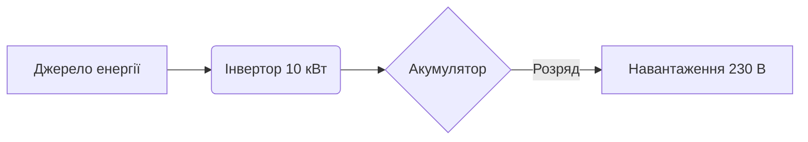

# Звіт: {{ project.title }}

* **Клієнт:** {{ client.name }} (м. {{ client.city }})
* **Дата:** {{ project.date }}

---

## 1. Схема процесу

## 2. Попередження щодо безпеки

> [!WARNING]
> **Увага при роботі з DC шиною:**
> Струми короткого замикання акумуляторного масиву можуть перевищувати 1000 А.

> [!NOTE]
> Усі роботи мають проводитися кваліфікованим персоналом.

## 3. Розрахункові формули

Струм навантаження інвертора розраховується за формулою:
$$I_{\text{DC}} = \frac{P}{\eta \cdot U_{\text{DC}}}$$

де $\eta = 0.93$, а напруга шини $U_{\text{DC}} = 51.2\text{ В}$.
